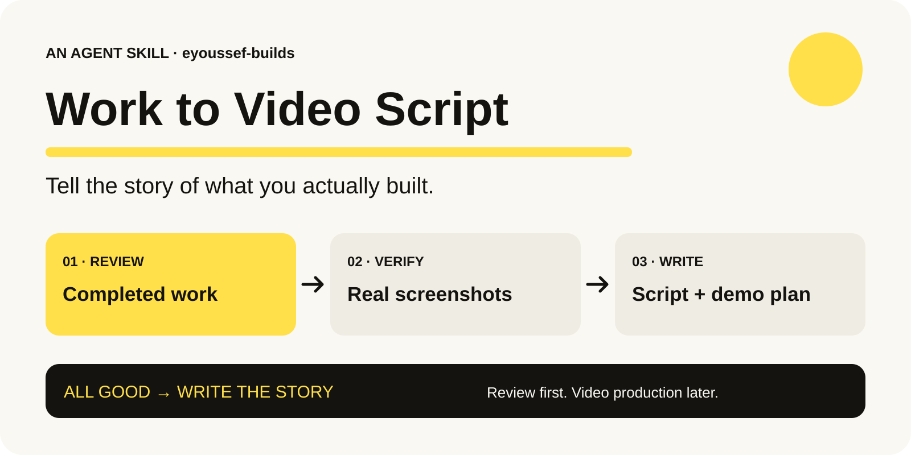
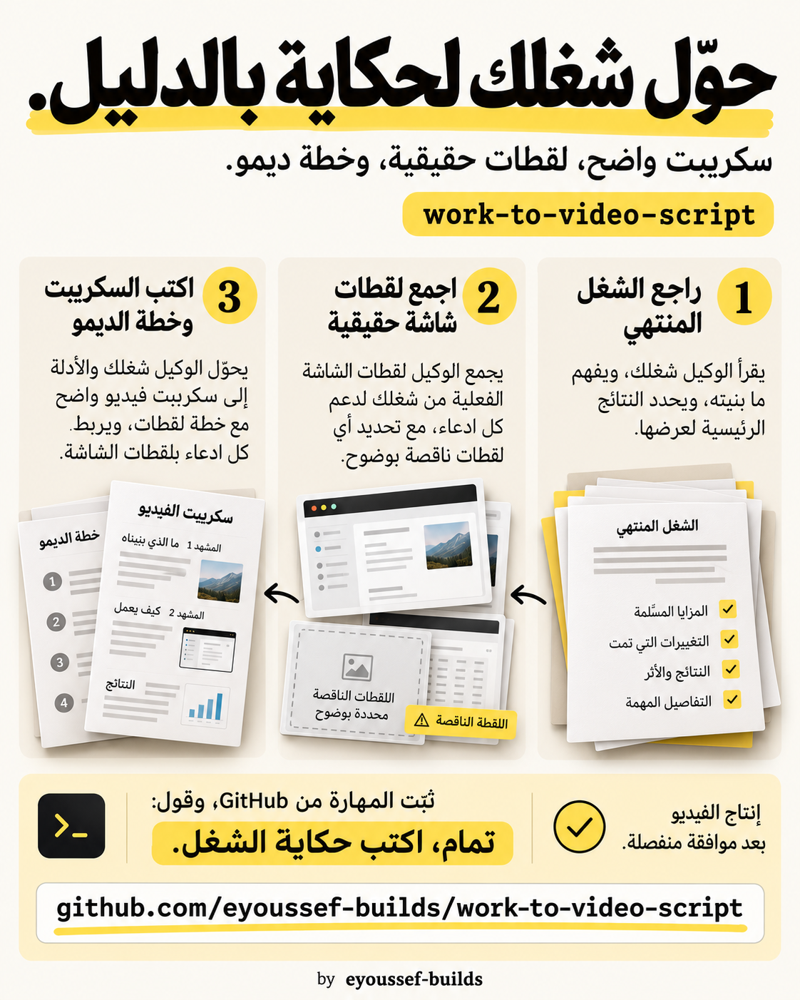

<div dir="rtl">

<p align="center"></p>

# Work to Video Script

**خلّصت المشروع؟ احكي حكايته… ومعاك الدليل.**

[English](README.md) · [التثبيت](docs/installation.ar.md) · [الخصوصية](docs/privacy.ar.md) · [مثال توضيحي](docs/example.md) · [ملفات المشاركة](docs/sharing.md)

بنيت حاجة مع مساعد ذكاء اصطناعي، لكن الحكاية متوزعة بين المحادثة والقرارات والكود والاختبارات ولقطات الشاشة. المهارة دي تجمع الأجزاء المهمة وتحوّلها لسكريبت فيديو، وصور حقيقية تدعم الكلام، وخطة واضحة لتصوير الديمو.

بعد ما تعتمد الشغل المنتهي، قول **«تمام، اكتب حكاية الشغل»**. راجع السكريبت الأول، وقرر إنتاج الفيديو في خطوة منفصلة.

## من شغل مكتمل لحكاية قابلة للمراجعة

1. **مراجعة الشغل:** المساعد يقرأ المهمة الحالية والمطلوب والتغييرات ونتائج التحقق الفعلية.
2. **جمع الأدلة:** يراجع الصور الموجودة، ويقدر يلتقط صورًا جديدة للواجهة الفعلية من خلال وصول مصرح به للقراءة فقط. أي لقطة ناقصة تفضل محددة بوضوح.
3. **كتابة السكريبت والخطة:** يكتب الكلام والمشاهد، ويربط الادعاءات المهمة بمصادرها، ويحدد خطوات الديمو اللي هيتصور لاحقًا.
4. **مراجعتك:** توليد الصوت وتحريك الشخصية وتسجيل الفيديو وإخراجه ونشره محتاجين طلب منفصل.



## هتستلم إيه؟

| الناتج | فايدته |
| --- | --- |
| سكريبت وتقسيم مشاهد | الكلام المنطوق، وتوقيت تقريبي، وإيه يظهر على الشاشة |
| صور حقيقية وفهرس لها | صور تقدر تراجعها، مربوطة بالمشاهد ومعروف مصدرها |
| سجل أدلة خاص | مصدر كل ادعاء مهم وحدود اللي اتأكدنا منه |
| خطة ديمو | البداية، والمدخلات، والنتائج الظاهرة، والانتظار، وتأثير الخطوات والتنظيف |
| قائمة باللقطات الناقصة | توضيح اللي لسه محتاج تصوير أو وصول |

مفيدة للمطورين وصنّاع المنتجات والمحتوى اللي عايزين يحكوا عن شغل خلص فعلًا. تقدر تستخدم شخصيتك المعتمدة في السرد؛ المهارة نفسها مافيهاش شخصية أو صوت جاهز.

## ثبّتها وابدأ

### اطلب من المساعد

</div>

```text
ثبّت مهارة work-to-video-script من
https://github.com/eyoussef-builds/work-to-video-script/tree/main/skills/work-to-video-script
للمساعد الحالي، مع الحفاظ على الملفات المساعدة وأي تخصيصات محلية موجودة.
```

<div dir="rtl">

الطريقة دي تحتاج مساعدًا يقدر يحمّل ويثبّت ملفات محلية. راجع أي طلب صلاحيات يعرضه البرنامج.

### أو انسخ المجلد بنفسك

حمّل [ملف المصدر ZIP](https://github.com/eyoussef-builds/work-to-video-script/archive/refs/heads/main.zip)، وفك الضغط، وانسخ **مجلد `skills/work-to-video-script` كاملًا** إلى مجلد مهارات مساعدك. المكان الشخصي المشترك في Codex الحالي هو `~/.agents/skills/`، وفي Claude Code هو `~/.claude/skills/`. [دليل التثبيت](docs/installation.ar.md) يشرح 15 مساعدًا، وخطوات Windows، وفحص ظهور المهارة، وبدائل قراءة التعليمات مباشرة.

جرّب الطلب ده:

</div>

```text
تمام، الشغل خلص. استخدم $work-to-video-script للمشروع اللي لسه خلصناه.
اكتب سكريبت بصوت المساعد، مع لقطات شاشة حقيقية وخطة ديمو.
استخدم شخصيتي ولغتي المعتمدين. ما تعملش الفيديو.
```

<div dir="rtl">

**اتأكد إنها ظهرت:** اطلب من المساعد يحدد مكان المهارة ويقرأ `SKILL.md` ويسمّي المرجعين الموجودين معاها. نسخ الملفات على جهازك مش معناه إنها اتاحت لمساعد شغال في السحابة.

## أول حكاية

1. خلّص المشروع واعتمد نتيجته.
2. خلّي ملفات المشروع والمحادثة ونتائج التحقق المتعلقة به متاحة للمساعد.
3. اطلب الحكاية. المراجعة تخص المشروع الحالي، مش كل مستودعاتك أو رسائلك.
4. راجع السكريبت والصور. أي رسالة حقيقية أو تعديل إنتاج أو استدعاء مدفوع يفضل في خطة الديمو اللاحقة ما لم يكن مصرحًا به بشكل منفصل.
5. عدّل السكريبت، وقرر إنتاج الفيديو في خطوة تانية.

[المثال الخيالي](docs/example.md) يوضح الفرق بين نجاح اختبار ونشر حقيقي، وإزاي تتحدد الصورة الناقصة من غير اختلاقها.

## المقصود بـ«تمام»

التشغيل حسب السياق: اعتماد شغل مشروع مكتمل. دي مش أداة بتراقب الكلمات أو بتسجل الشاشة في الخلفية. الموافقة على اقتراح أثناء الشغل، أو على السكريبت الناتج، ماتبدأش حكاية جديدة. لو المساعد ما اختارش المهارة تلقائيًا، اطلبها بالاسم.

## الخصوصية والوصول

المهارة تعليمات وقوالب؛ مافيهاش برنامج جمع بيانات أو ربط حسابات أو مفتاح API مطلوب. المساعد والنموذج المستخدم بيشوفوا المواد اللي بتتيحها لهم، وأي خدمة متصلة للتصوير ليها صلاحياتها وسياساتها. استخدام المساعد ممكن يكون مدفوعًا حسب خطتك أو المزوّد.

الصور الأصلية وسجل الأدلة ومسارات المصادر تفضل في مخرجات خاصة بالمشروع. النسخة القابلة للمشاركة تستخدم صورًا تمت مراجعتها وإخفاء البيانات الحساسة منها. التثبيت ما يمنحش وصولًا لتاريخ مساعدين تانيين أو جهازك كله أو حسابات خاصة أو مستلمين خارجيين. [دليل الخصوصية](docs/privacy.ar.md).

<details>
<summary>تقدر ترجع تسجيل شاشة قديم ما اتسجلش؟</summary>

تقدر تسترجع الحكاية من السجلات والصور الموجودة. ما تقدرش تختلق تسجيلًا للضغطات القديمة. الصور الحالية والديمو المصور لاحقًا بيتحددوا بوضوح.
</details>

<details>
<summary>هل بتعمل الفيديو وتنشره؟</summary>

بتقف عند السكريبت والصور وخطة الديمو. الموافقة على السكريبت وحدها مش إذن لتوليد صوت أو تحريك شخصية أو تسجيل فيديو أو نشره أو إرسال رسائل تجربة فعلية.
</details>

<details>
<summary>بتشتغل على كل المساعدين؟</summary>

التعليمات قابلة للتحميل في مساعدين يدعموا المهارات، أو للقراءة كتعليمات صريحة. الوصول للمحادثات والملفات وتصوير المتصفح بيتحدد حسب البرنامج. دليل التثبيت مش ادعاء إننا اختبرنا التشغيل كاملًا في كل برنامج مذكور.
</details>

<details>
<summary>أقدر أختار الشخصية واللغة؟</summary>

طبعًا، في الطلب أو ملف محلي اختياري باسم `references/local-profile.md` داخل النسخة المثبتة عندك. الملف ده يفضل خارج أي توزيع عام. المهارة المنشورة مافيهاش ربط بحسابات شخصية أو رسومات لشخصية بعينها.
</details>

## الترخيص والمشاركة

ترخيص [MIT](LICENSE) يسمح بالاستخدام والتعديل. تكلفة المساعد والخدمات منفصلة. [ملفات المشاركة](docs/sharing.md) فيها إنفوجرافيك عربي وإنجليزي وتصميم فيسبوك ونصوص إعلان مقترحة. الرسومات دي بتشرح المهارة؛ مش أدلة على نتيجة مشروع حقيقي.

ملفات التشغيل: `SKILL.md`، وبيانات الواجهة في `agents/openai.yaml`، ودليل الأدلة وقالب التسليم في `references/`. مافيش برنامج مسح تنفيذي مرفق. اتعملت مراجعة للبنية والمصادر و[حالات السلوك](docs/behavioral-review.md)، من غير ادعاء اختبار التشغيل في كل المساعدين.

نشر [eyoussef-builds](https://github.com/eyoussef-builds).

</div>
