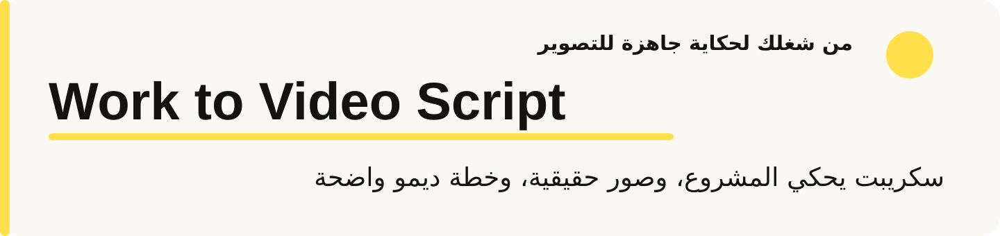
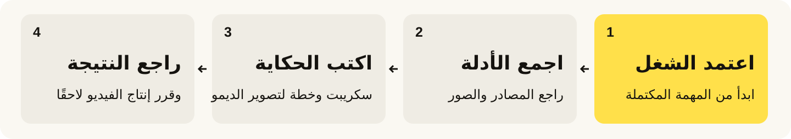
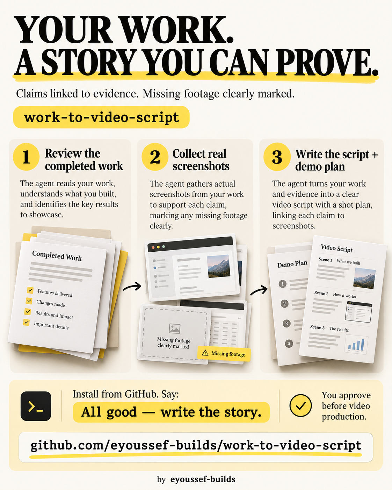
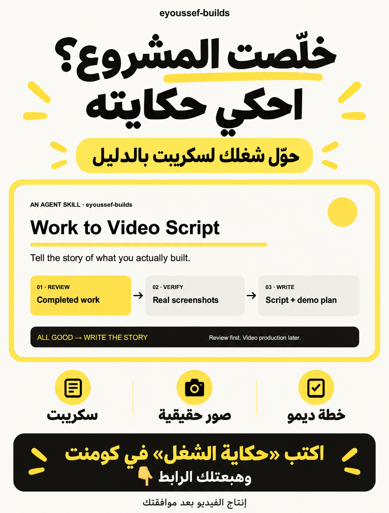

<div dir="rtl">

<p align="center"></p>

<p align="center"><a href="README.md"><b>Read in English</b></a> · <a href="#install">التثبيت</a> · <a href="#first-use">جرّبها</a> · <a href="#questions">أسئلة</a> · <a href="#share">المشاركة</a></p>

<p align="center"><a href="LICENSE"></a> <a href="docs/installation.ar.md"></a> </p>

## 👋 إيه هي Work to Video Script؟

أنت ومساعدك خلّصتوا بناء مشروع. دلوقتي عايز فيديو يحكي بدأ إزاي، واخترتوا إيه أثناء الشغل، والنتيجة بتشتغل إزاي. الحكاية موجودة، لكن متوزعة بين المحادثة وتغييرات الكود والاختبارات والصور.

**Work to Video Script بتدي مساعدك طريقة يحوّل بيها الشغل المكتمل لسكريبت بصوته، وصور شاشة حقيقية، وخطة ديمو جاهزة للتصوير.**

1. **يراجع اللي حصل:** المشكلة والقرارات والتغييرات والنتيجة اللي اتأكدتم منها.
2. **يجمع الصور الحقيقية:** يستخدم صور المشروع الفعلية ويوضح إيه لسه محتاج تصوير.
3. **يكتب الحكاية:** كلام ومشاهد، مع مصدر يدعم كل ادعاء مهم.
4. **يخطط للديمو:** خطوات ومدخلات ونتائج ظاهرة. أنت تراجع قبل إنتاج الفيديو.

<p align="center"></p>

**المهارة** مجلد تعليمات مساعدك يقدر يتبعها. دي مش محرر فيديو أو مسجل شاشة تلقائي؛ بتساعد المساعد يجهّز الحكاية باستخدام الملفات والمحادثات وأدوات التصوير المتاحة له.

### تساعدك تحكي إيه؟

| عايز تعرض… | المساعد يجهّز… |
| --- | --- |
| 💡 المشروع بدأ إزاي | افتتاحية واضحة والمشكلة الحقيقية اللي كنت بتحلها |
| 🛠️ بنيتوه إزاي | القرارات والتحولات المفيدة، مع نسبة الشغل لأصحابه بدقة |
| 📸 إيه اللي حصل فعلًا | صور فعلية، وسياق التقاطها، وربطها بالمشاهد المناسبة |
| 🎙️ المساعد بيحكي | كلام بلسانه، بلغتك وبالشخصية اللي اعتمدتها |
| 🧪 النتيجة بتشتغل إزاي | خطة ديمو بمدخلات محددة ونتائج تقدر تشوفها وخطوات تنظيف |
| ✅ إيه الجاهز للمراجعة | السكريبت وفهرس الصور وسجل مصادر خاص واللقطات الناقصة |

مناسبة للمطورين وصنّاع المنتجات والمحتوى اللي بيحكوا رحلة بناء أو يشرحوا ميزة أو يلخصوا مشروعًا. أنت تختار الجمهور واللغة والشخصية والمدة التقريبية. رسومات الشخصية والصوت المولّد مش مضمّنين.

<a id="install"></a>

## 📥 التثبيت — خطوة بخطوة

**تحتاج:** مساعدًا يقدر يقرأ الشغل المكتمل. الصور الجديدة تحتاج أداة تصوير متصفح أو تطبيق ووصولًا للمشروع. المهارة ما بتضيفش أدوات أو بيانات دخول أو وصولًا لتاريخ مساعدين تانيين.

### أسهل طريقة: اطلب من المساعد يثبّتها

1. افتح جلسة تسمح بتنزيل وحفظ الملفات.
2. انسخ وأرسل:

</div>

```text
ثبّت work-to-video-script من https://github.com/eyoussef-builds/work-to-video-script.
اقرأ دليل التثبيت وافحص المهارة أولًا، وثبّت مجلد skills/work-to-video-script كاملًا
في مكان المهارات الشخصية المدعوم للبرنامج. حافظ على أي نسخة معدّلة.
وضح أدوات قراءة شغل المشروع وتصوير الشاشة المتاحة لك.
```

<div dir="rtl">

3. راجع أي طلب إذن للتنزيل أو حفظ الملفات.
4. اتأكد إنها ظهرت: «هل ترى work-to-video-script؟ اقرأها وحدد المرجعين اللي معاها».

### تفضّل تنسخها بنفسك؟

1. [حمّل ZIP](https://github.com/eyoussef-builds/work-to-video-script/archive/refs/heads/main.zip).
2. فك الضغط: انقر مرتين على الماك؛ وفي Windows اضغط بالزر الأيمن ثم **Extract All…**.
3. افتح **skills** وهتلاقي مجلد **work-to-video-script** كاملًا.
4. انسخه للمكان الموجود في [دليل مساعدك](docs/installation.ar.md).
5. حدّث قائمة المهارات أو أعد فتح المساعد عند الحاجة، واطلب المهارة بالاسم.

الدليل يغطي **15 مساعدًا** بأماكن تثبيت موثقة أو بدائل قراءة تعليمات موضحة، وخطوات macOS وLinux وWindows. مراجعة الوثائق مش اختبار تشغيل كامل في كل مساعد. المساعد السحابي يحتاج نسخة وأدلة متاحة في بيئته.

<a id="first-use"></a>

## 🚀 أول حكاية لمشروعك

### 1. خلّص الشغل واطلب حكايته

بعد ما تعتمد المشروع في Codex، جرّب:

</div>

```text
تمام، الشغل خلص. استخدم $work-to-video-script للمشروع اللي لسه خلصناه.
اكتب سكريبت مدته حوالي 3 دقائق بلسان مساعدي، مع صور حقيقية وخطة ديمو.
راجع المهمة الحالية وملفات المشروع. ما تعملش الفيديو.
```

<div dir="rtl">

في Claude Code استخدم `/work-to-video-script`، وللمساعدين التانيين طريقة الاستدعاء الخاصة بيهم. «تمام» ممكن تختار المهارة حسب سياق اعتماد الشغل؛ دي مش أداة بتراقب الكلمات. اعتماد اقتراح أثناء العمل أو سكريبت موجود ما يبدأش حكاية جديدة.

### 2. اختار مين بيحكي ولمين

وضح الجمهور واللغة والشخصية والمدة التقريبية. لو اختارتهم في المهمة، المساعد يستخدم الاختيارات الموجودة. مثلًا: «مصري، وأسماء المنتجات بالإنجليزي، بشخصيتي المعتمدة، لناس ما شافتش المشروع». التفضيلات المحلية الخاصة ممكن تحفظ الاختيارات دي بدون نشرها مع المهارة.

### 3. سيبه يراجع الشغل الفعلي

يتابع قرارات المشروع وتغييراته ونتائج التحقق. الصور الموجودة ممكن تعرض مراحل سابقة؛ والصورة الجديدة للواجهة الحالية تثبت حالتها وقت التصوير. لو لقطة محتاجة رسالة فعلية أو تعديل إنتاج، تتحط في خطة الديمو اللاحقة. اللقطة الناقصة تتحدد بدل ما تتبدّل بصورة مختلقة.

### 4. راجع السكريبت والمشاهد

تستلم الكلام المنطوق، وتوقيتات تقريبية، وإيه يظهر على الشاشة، وروابط الصور الحقيقية بعد إخفاء البيانات الحساسة. سجل المصادر الخاص يفرق بين اللي اتنفذ، واللي اتختبر، واللي اتنشر، واللي مستخدم جربه فعلًا.

**مثال خيالي:** خلّصت ميزة لقائمة مهام، ومعاك سجل اختبارات محلية وصورة حالية واحدة، لكن مافيش دليل نشر أو تسجيل شاشة قديم.

| المشهد | مثال للكلام | إيه يظهر؟ |
| --- | --- | --- |
| المشكلة | «عشان نلاقي المهمة الجاية، كنا بنفتح 3 قوائم» | إعادة صياغة للمشكلة اللي قدمتها، مش اقتباس مختلق |
| النتيجة | «جمعنا الخطوة الجاية في مكان واحد» | الصورة الفعلية المتاحة، مع توضيح إنها حالية |
| التحقق | «الاختبارات المحلية نجحت» | نتيجة الاختبار المتعلقة بالميزة، بدون ادعاء إن التطبيق اتنشر |
| الديمو | «نضيف مهمة، نكملها، ونعيد تحميل الصفحة» | خطة تسجيل بنتائج واضحة لكل خطوة |

المستودع مافيهوش صورة لهذا المشروع الخيالي. وقت الاستخدام، روابط الصور لازم تشير للقطات فعلية من مشروعك. [شوف المثال وخطة الديمو كاملين](docs/example.md).

### 5. قرر الخطوة اللي بعدها

عدّل الحكاية واعتمد السكريبت. المهارة تقف هنا. توليد الصوت وتحريك الشخصية وتسجيل الفيديو وإخراجه أو نشره طلب منفصل. خطة الديمو توضح خطوات الاختبار والوصول المطلوب لاحقًا؛ ما بتنفّذهاش لمجرد الحصول على لقطة.

## 🔒 الخصوصية في دقيقة

- المراجعة تخص أدلة المهمة الحالية؛ المستودعات والرسائل غير المتعلقة بيها خارج النطاق.
- الصور الأصلية ومسارات المصادر والتفضيلات تفضل في ملفات خاصة. نسخ الصور القابلة للمشاركة تتراجع بعد القص وإخفاء البيانات الحساسة.
- المساعد والنموذج وأي خدمة تصوير متصلة بيطبقوا إعداداتهم على المدخلات. الحزمة مافيهاش برنامج جمع بيانات أو بيانات دخول.

[دليل الخصوصية](docs/privacy.ar.md) يشرح التعامل مع الصور وملفات المخرجات الخاصة وحدود الوصول.

<a id="questions"></a>

## ❓ أسئلة وأجوبة

<details><summary><b>هل هي مجانية؟</b></summary>

المهارة مجانية ومفتوحة المصدر بترخيص MIT، بما فيه الاستخدام التجاري مع إبقاء إشعار الرخصة. المساعد والنموذج والخدمات المتصلة ليهم تكاليفهم. المهارة نفسها ما تحتاجش مفتاح API منفصلًا.

</details>

<details><summary><b>هتسجل كل حاجة وأنا بشتغل؟</b></summary>

ما بتثبّتش مسجلًا في الخلفية. بعد الاعتماد، تسترجع الحكاية من السجلات المتاحة. لو استخدمتها صراحة أثناء البناء، تقدر تحفظ أدلة المراحل المفيدة في مخرجات المشروع الخاصة المسموح بها. ما تقدرش ترجع تسجيل شاشة ما اتعملش.

</details>

<details><summary><b>لو مش قادرة توصل للصور أو المحادثة؟</b></summary>

تستخدم المتاح وتوضح النقص. أداة المتصفح ممكن تلتقط الواجهة الحالية المسموح بها، لكنها ما تثبتش ضغطات قديمة. بدون صور، حزمة اللقطات تفضل جزئية والمطلوب تصويره يتحدد.

</details>

<details><summary><b>أقدر أختار شخصيتي ولغتي؟</b></summary>

نعم، في الطلب أو ملف `references/local-profile.md` الخاص داخل النسخة المثبتة عندك. الملف يفضل خارج أي توزيع عام. المهارة ما بتخترعش شكل الشخصية أو تفرض هوية شخص تاني.

</details>

<details><summary><b>اعتماد السكريبت يبدأ إنتاج الفيديو؟</b></summary>

لا. ما تولدش صوتًا أو تسجل ديمو أو ترسل رسائل اختبار أو تحرك الشخصية أو تخرج وتنشر الفيديو كنتيجة جانبية لاعتماد السكريبت. الخطوة التالية بطلب منفصل.

</details>

<details><summary><b>اتجربت في كل المساعدين الـ15؟</b></summary>

الدليل يوثق طرق التثبيت وقراءة التعليمات؛ مش شهادة اختبار تشغيل. المحادثات والملفات وأدوات التصوير ومجلدات الحفظ الخاصة حسب البرنامج والبيئة. اطلب المهارة بالاسم لو الاختيار التلقائي ما اختارهاش.

</details>

<details><summary><b>أحدّثها أو أحذفها إزاي؟</b></summary>

قارن التنزيل الجديد بالمثبت واحفظ ملفك الخاص وتخصيصاتك. للإزالة احذف مجلد المهارة المثبت فقط وحدّث قائمة المهارات. مخرجات الحكايات ملفات منفصلة؛ احذفها بقرار منك لما ما تحتاجهاش. راجع [دليل التثبيت والصيانة](docs/installation.ar.md).

</details>

<a id="share"></a>

## 🖼️ شارك المهارة

[إنفوجرافيك إنجليزي](docs/images/infographic-en.png) · [إنفوجرافيك عربي](docs/images/infographic-ar.png) · [تصميم فيسبوك](docs/images/facebook-post-ar.png) · [نصوص السوشيال الأربعة](docs/social-posts.ar.md) · [نصوص باللغتين](docs/sharing.md)

<p align="center"><a href="docs/images/infographic-en.png"></a> <a href="docs/images/infographic-ar.png"></a></p>

<p align="center"><a href="docs/images/facebook-post-ar.png"></a></p>

الرسومات العامة بتشرح المهارة، وليست صورًا تاريخية لشغل حقيقي. تجهيز نصوص الإعلان مش معناه نشرها أو إعداد أتمتة التعليقات.

## 🛠️ إيه الموجود جوّه؟

</div>

```text
skills/work-to-video-script/
  SKILL.md       مراجعة الشغل والسرد والصور الحقيقية وخطة الديمو
  references/    قرارات الأدلة وقالب حزمة المراجعة
  agents/        بيانات Codex
docs/            الأدلة باللغتين والمثال الخيالي وحالات المراجعة ورسومات المشاركة
```

<div dir="rtl">

المهارة تعليمات فقط؛ مافيهاش برنامج مسح أو إخراج فيديو أو قاعدة حسابات أو خدمة خلفية. [حالات المراجعة](docs/behavioral-review.md) توضح حدود السلوك المهمة. فحص بنية الملفات مختلف عن اختبار سلوك النموذج فعلًا.

## 🤝 الدعم

[افتح بلاغًا](https://github.com/eyoussef-builds/work-to-video-script/issues) بالعربي أو الإنجليزي بمثال خيالي. ما ترفقش صور مشروع خاص أو رسائل عملاء أو مفاتيح. للأمور الخاصة: [hello@eyoussef.me](mailto:hello@eyoussef.me).

**إعداد [eyoussef-builds](https://github.com/eyoussef-builds)** · [hello@eyoussef.me](mailto:hello@eyoussef.me) · [eyoussef.me](https://eyoussef.me) · [MIT](LICENSE)

</div>
