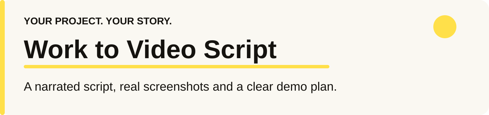
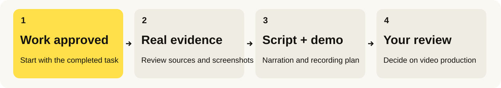

<p align="center"></p>

<p align="center"><a href="README.ar.md"><b>اقرأ الدليل بالعربية</b></a> · <a href="#install">Install</a> · <a href="#first-use">Try it</a> · <a href="#questions">Questions</a> · <a href="#share">Share</a></p>

<p align="center"><a href="LICENSE"></a> <a href="docs/installation.md"></a> </p>

## 👋 What is Work to Video Script?

You and your AI assistant just finished building something. Now you want a video showing how it started, the choices you made and how the result works. The story is there—but scattered across the conversation, code changes, tests and screenshots.

**Work to Video Script gives your assistant a way to turn that completed work into a narrated script, real screenshots and a demo you can plan to record.**

1. **Review what happened:** recover the problem, decisions, changes and verified result.
2. **Gather real screenshots:** use actual project captures and identify what still needs filming.
3. **Write the story:** prepare narration and scenes, matching important claims to their sources.
4. **Plan the demo:** specify actions, inputs and visible results. You review before making a video.

<p align="center"></p>

A **skill** is a folder of instructions your AI assistant can follow. This one is not a video editor or automatic screen recorder. It helps your assistant prepare the story using the files, history and screenshot tools available to it.

### What can it help you explain?

| You want to show… | The assistant prepares… |
| --- | --- |
| 💡 How the project started | A clear opening and the actual problem you wanted to solve |
| 🛠️ How you built it | Decisions and useful turning points, with honest attribution |
| 📸 What really happened | Actual screenshots, their capture context and links to the relevant scenes |
| 🎙️ Your assistant telling the story | First-person narration in your chosen language and approved avatar's voice |
| 🧪 How the result works | A demo plan with exact inputs, observable checkpoints and cleanup |
| ✅ What is ready for review | The script, screenshot index, private source record and any capture gaps |

Useful for developers, makers and creators sharing a build story, feature walkthrough or project recap. You choose the audience, language, narrator and approximate length. Avatar artwork and generated voice are not included.

<a id="install"></a>

## 📥 Install it — step by step

**You need:** an assistant that can read the relevant completed work. New screenshots require an available browser/app capture tool and access to the project. The skill does not supply tools, credentials or access to another agent's history.

### Easiest: ask your assistant to install it

1. Open a session that can download and save files.
2. Copy and send:

   ```text
   Install work-to-video-script from https://github.com/eyoussef-builds/work-to-video-script.
   Read the installation guide and inspect the skill first. Install the complete
   skills/work-to-video-script folder in this agent's supported personal skill directory.
   Preserve any customized copy. Tell me what project-history and screenshot tools you have.
   ```

3. Review any download/file permission request.
4. Check it appeared: “Can you see work-to-video-script? Read it and identify its two references.”

### Prefer copying it yourself?

1. [Download ZIP](https://github.com/eyoussef-builds/work-to-video-script/archive/refs/heads/main.zip).
2. Unzip it: double-click on Mac; on Windows right-click → **Extract All…**.
3. Open **skills** and find the complete **work-to-video-script** folder.
4. Copy it to the location in [your agent's guide](docs/installation.md).
5. Reload/reopen skill discovery if needed, then request it by name.

The guide covers **15 agents**, with documented native locations or clearly labeled instruction-reading alternatives, plus macOS/Linux and Windows steps. Documentation checks are not end-to-end tests in every agent. Cloud agents need their own accessible copy of the skill and project evidence.

<a id="first-use"></a>

## 🚀 Your first build story

### 1. Finish the work, then ask for its story

After approving the project in Codex, try:

```text
All good. Use $work-to-video-script for the project we just completed.
Write a 3-minute first-person script in my assistant's voice, with real screenshots
and a demo plan. Use the active task and project files. Do not create the video.
```

In Claude Code use `/work-to-video-script`; other agents have their own invocation controls. “All good” can prompt contextual skill selection; it is not a global keyword listener. Approval of an intermediate choice or an existing script does not start another story.

### 2. Choose who tells it and who watches

Tell the assistant your audience, language, narrator and approximate duration. If you already chose these in the task, it should reuse them. For example: “Egyptian Arabic, English product names, my approved avatar, for people who have not seen the project.” Private installed preferences can save these choices without publishing personal configuration.

### 3. Let it review the actual work

It follows the active project's decisions, changes and verification records. Existing screenshots can show earlier milestones; a new read-only capture shows the current result. If a view needs a live message or production change, it goes into the later demo plan. Missing footage is identified rather than replaced by an invented screenshot.

### 4. Review the script and the scenes

You receive spoken narration, approximate timings, on-screen actions and links to real safe screenshots. The private source record separates what was implemented, tested, deployed and actually tried by a user.

**An invented example:** you finished a fictional task-list feature. You have a local test log and one current screenshot, but no deployment proof or historical recording.

| Scene | Sample narration | What the viewer would see |
| --- | --- | --- |
| Problem | “Finding the next task meant opening three lists.” | A paraphrase of the supplied problem, not an invented quote |
| Result | “We put the next action in one place.” | Your actual current screenshot, labeled as current |
| Check | “The local checks passed.” | The relevant test result; no claim that it was deployed |
| Demo | “Add a task, mark it complete, then reload.” | A planned recording with visible checkpoints |

No screenshot from that fictional project is shipped here. During actual use, image links must point to genuine project captures. [See the complete example and demo plan](docs/example.md).

### 5. Decide what happens next

Edit the story and approve the script. The skill stops there. Generating a voice, animating an avatar, recording/rendering a video or publishing it is a separate request. The demo plan records later test actions and access needed; it does not execute them just to obtain footage.

## 🔒 Privacy in one minute

- Only the active task's relevant evidence is reviewed; unrelated repos and inboxes stay outside the scan.
- Raw screenshots, private source references and personal preferences stay in private project outputs. Shareable crops/redactions are reviewed separately.
- Your assistant/model and any connected screenshot service process inputs under their own settings. This package contains no executable collector or account credentials.

Read the [privacy guide](docs/privacy.md) for image handling, private outputs and access boundaries.

<a id="questions"></a>

## ❓ Questions & answers

<details><summary><b>Is it free?</b></summary>

The skill is free and open source under MIT, including commercial use with the license notice retained. Your assistant, model and connected services keep their own costs. The skill itself needs no separate API key.

</details>

<details><summary><b>Will it record everything while I work?</b></summary>

No background recording is installed. After approval, it reconstructs the story from available records. If you explicitly use the skill during the build, it can preserve useful milestone evidence in the allowed private output area. It cannot recover a screen recording that was never made.

</details>

<details><summary><b>What if it cannot access my screenshots or history?</b></summary>

It uses evidence available to that host and states the gaps. A browser screenshot tool can capture an authorized current view; it cannot prove earlier clicks. Without captures, the screenshot pack remains partial and missing shots are listed.

</details>

<details><summary><b>Can I choose my own avatar and language?</b></summary>

Yes. Supply them in the request or your installed copy's private `references/local-profile.md`. Keep that profile out of public exports. The skill does not invent an avatar's appearance or bundle someone else's identity.

</details>

<details><summary><b>Does approving the script start video production?</b></summary>

No. It does not generate voice, record a demo, send test messages, animate the avatar, render or publish as a side effect of script approval. Give a separate instruction for the next step.

</details>

<details><summary><b>Does it work in all 15 agents?</b></summary>

The guide documents installation/import routes; it is not an execution certification. Available history, files, browser captures and private output folders depend on your agent and environment. Explicitly invoke the skill if contextual selection does not choose it.

</details>

<details><summary><b>How do I update or remove it?</b></summary>

Compare a new download with the installed folder and preserve your local profile/customizations. Remove only the installed skill folder to uninstall and refresh discovery. Private story outputs are separate files; remove them deliberately when no longer needed. See [installation and maintenance](docs/installation.md#updating-and-uninstalling).

</details>

<a id="share"></a>

## 🖼️ Share this skill

[English infographic](docs/images/infographic-en.png) · [Arabic infographic](docs/images/infographic-ar.png) · [Facebook promo](docs/images/facebook-post-ar.png) · [Four Arabic social-copy blocks](docs/social-posts.ar.md) · [Bilingual captions](docs/sharing.md)

<p align="center"><a href="docs/images/infographic-en.png"></a> <a href="docs/images/infographic-ar.png"></a></p>

<p align="center"><a href="docs/images/facebook-post-ar.png"></a></p>

These public illustrations explain the skill; they are not historical screenshots of a real build. Draft announcement copy does not mean posting or comment automation has been configured.

## 🛠️ What is inside?

```text
skills/work-to-video-script/
  SKILL.md       Work review, narration, real screenshots and demo planning
  references/    Evidence decisions and a review-pack template
  agents/        Codex metadata
docs/            Bilingual guides, fictional example, review cases and share artwork
```

This is an instruction-only skill, with no bundled scanner, video renderer, account database or background service. See the [review scenarios](docs/behavioral-review.md) for its behavior boundaries. Structural validation is separate from testing actual model behavior.

## 🤝 Support

[Open an issue](https://github.com/eyoussef-builds/work-to-video-script/issues) in English or Arabic with an invented example. Do not attach private project screenshots, customer messages or credentials. For private matters: [hello@eyoussef.me](mailto:hello@eyoussef.me).

**Created by [eyoussef-builds](https://github.com/eyoussef-builds)** · [hello@eyoussef.me](mailto:hello@eyoussef.me) · [eyoussef.me](https://eyoussef.me) · [MIT](LICENSE)
